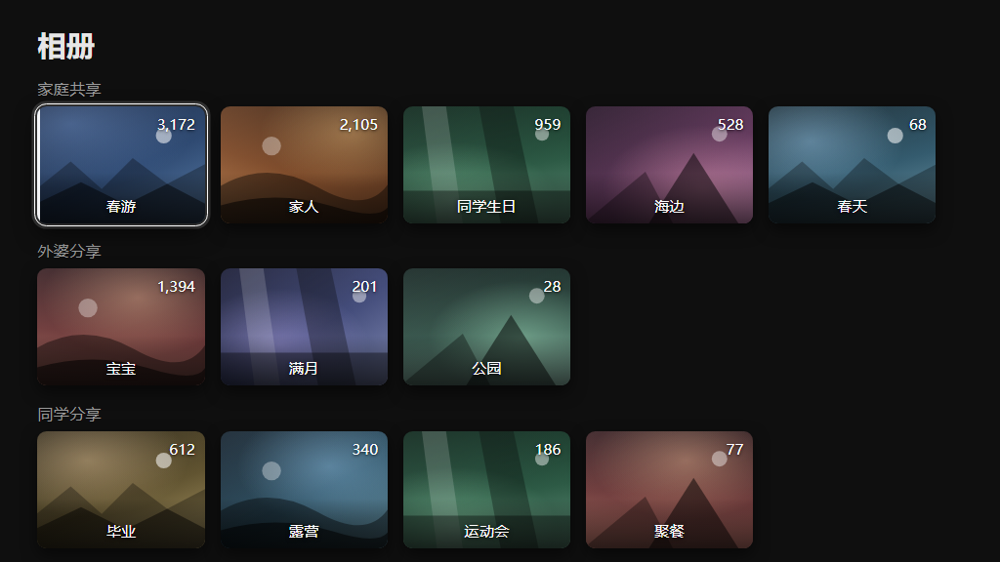
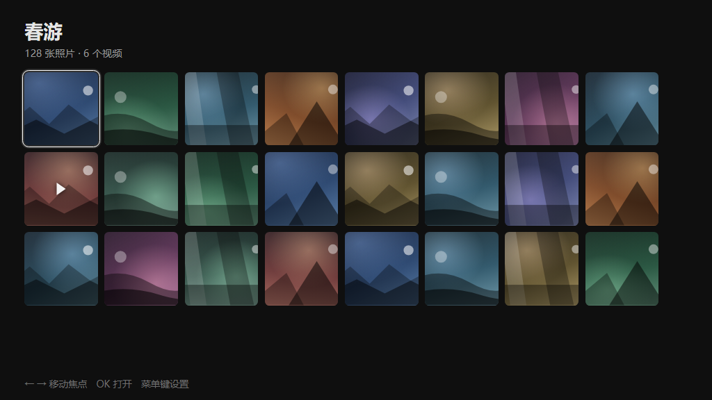
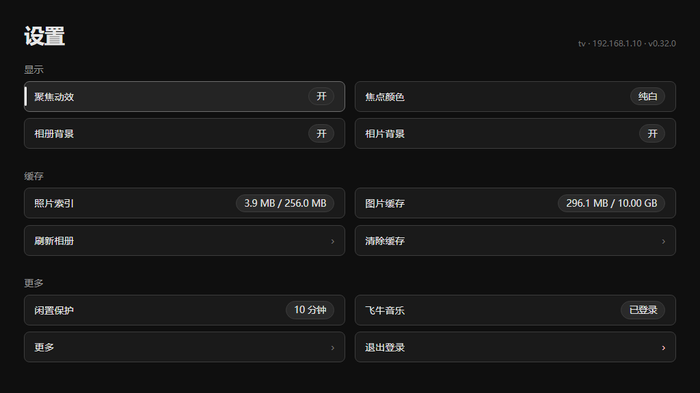

# FN 共享相册

> **非官方项目**：个人独立开发，与飞牛（fnOS）官方没有任何隶属、合作或授权关系，详见[免责声明](#免责声明)。

飞牛（fnOS）共享相册的 Android TV 客户端。只读。客厅里播家人愿意一起看的相册，其它照片看不到。

## 为什么做这个

家里的 NAS 存着大量私人照片，但客厅电视是全家人共用的：客人来了、孩子拿着遥控器乱按，都可能翻到不该摊开的东西。

所以这个应用从一开始就没打算做「把整个相册搬上电视」。它的做法是：在 NAS 上单独开一个账号，家人把自己愿意给全家看的那几个相册共享给它，电视只登这个账号。电视能看到的，正好就是被共享出来的那一部分；没共享的照片，在这台电视上连入口都不存在。

「只显示共享相册」不是功能没做完，是设计前提。同理，它刻意不提供上传、删除、编辑、导出——电视端只负责看。

## 使用建议

**在飞牛上单独开一个 TV 账号，只用来在电视上看照片。**

家人把要看的相册共享给这个账号，电视端只登它；想加相册、撤相册，都在 NAS 上改，电视端不用动。这样私人的照片始终留在你自己的账号里，电视能看到的就只有被主动共享出来的那几本。

**相册怎么排，按相册类型自动区分：**

- **宝宝相册**：按「X 岁 X 月 X 天」分组，一天一组，翻起来像看孩子一天天长大。
- **普通相册**：按年月日排时间轴，就是拍摄日期那套顺序。

## 界面预览

> 下面几张**不是真机截图**，是照着界面结构粗略画的示意图，用来看清每一页有哪些内容、大概怎么排布，不追求像素级还原。照片位置全部换成抽象色块，仓库里不会出现任何人的照片。

静态图也有画不出来的部分：背景的模糊与毛玻璃质感、焦点移过去时的放大和亮边、幻灯片换图时的叠化与缓慢推拉，都是动起来才成立的效果。图只能说明页面长什么样，实际手感要装上 App 才看得见。

|  |  |
|:---:|:---:|
| <br><sub>相册墙：按共享者分组，封面只有张数</sub> | <br><sub>照片列表：视频格带播放三角</sub> |
| <br><sub>看图页：左上信息框，底部按键提示</sub> | <br><sub>幻灯片：右侧两列竖排歌词，当前句亮</sub> |



<sub>设置页：六行双列，每行等高 50dp；左列右侧是值胶囊，纯箭头的行留给会跳转的操作</sub>

## 它好用的地方

### 幻灯片：会动，不是一张张硬切

- 每张停 3 / 5 / 8 秒可选，切换是 0.8~1 秒的叠化，不是「啪」地跳过去。
- 画面在停留期间缓慢推近或拉远（Ken Burns），并且推近、拉远交替：上一张推到 1.08，下一张就从 1.08 往回走，连起来像镜头一直在动，不会出现「胀一下、缩一下」的呼吸感。
- 放大和叠化都能单独关掉，四种组合都自洽。
- 顺序或随机；可循环；自动前进时跳过视频（视频留给你手动按）。

### 背景音乐与歌词

- 两种音源：登录飞牛音乐后播自己的歌单，或直接读电视本地音乐。
- 播放时屏幕右侧显示歌词：两列竖排、字从上往下读，逐句淡入；字体是霞鹜文楷子集，和界面的黑体区分得开，3 米外也认得出。
- 幻灯片在放、照片在翻，音乐不断。

### 磨砂玻璃背景

- 相册墙和照片页的背景取当前相册的画面，高斯模糊 12dp 再叠一层细噪点，得到磨砂玻璃的质感；换相册，背景跟着换。
- 只模糊、不调色，原图的颜色和饱和度保持原样。

### 焦点动画

- 遥控器移动焦点时，相册封面、照片格、按钮会轻微放大（1.04~1.06）并亮起描边，设置页的行还会在左侧亮一条竖条——3 米外一眼看得出焦点在哪。
- 焦点颜色可以换，改一处，全局统一。

### 按电视的用法设计

- 相册墙只列「别人共享给我的相册」，按共享人分组，封面上标张数。
- 照片网格每页 60 张，滚到剩两行自动续页；视频混在照片里，缩略图中心有 ▶ 角标，点开直接播。
- 看大图：左右键翻页，上键呼出菜单，OK 放大后用方向键挪取景框，菜单键看照片信息（分辨率、大小、时长）。
- 返回键逐层退回：先收菜单或信息框，再退一层，不会一下跳回桌面。

### 视频

- 点开从首帧起播；等首帧真正画出来才出声，避免「黑屏先响」。
- 暂停、播完、快进都有对应提示；退出播放立刻停声，回到相册不会听见上一段残留。

### 新版本提醒

- 冷启动后台检查 GitHub / Gitee 的 Release，一天最多一次；有新版只在相册墙弹窗，下载完成后交给系统确认安装。
- 检测走独立网络通道，不碰 NAS 的登录配置。

## 安装与运行

用 Android Studio 或 Gradle 8.14 构建 `app` 模块，安装到 Android TV（`minSdk 26`）：

```sh
gradle :app:assembleDebug
adb install -r app/build/outputs/apk/debug/app-debug.apk
```

首次启动填入 NAS 地址（只填 IP，如 `192.168.1.100`，不带端口）、账号、密码，按需填访问码；自签证书会弹一次信任确认。

安装包见 [GitHub Releases](https://github.com/ASH-C776/fn-share-tv/releases)
或 [Gitee Releases](https://gitee.com/kijeye/fn-share-tv/releases)。

## 免责声明

FN 共享相册是个人独立开发的开源第三方应用，与飞牛（fnOS）官方没有任何隶属、合作或授权关系。

「FN」只是产品代号，不是品牌缩写，也不暗示官方关联；文中提到「飞牛相册服务器」仅用于说明所适配的协议类型。相关商标权益归飞牛官方所有。

## 许可证

MIT，全文见 [LICENSE](LICENSE)。

## 关于来源

这是一个独立实现，代码从零开始写，与任何现有客户端没有代码级共用。

飞牛相册的接口没有公开文档，协议细节参考了两个公开的逆向项目：
[FNOSP/fnnas-api](https://github.com/FNOSP/fnnas-api)（MIT）与
[HelloWangXiangDong/fnAlbum](https://github.com/HelloWangXiangDong/fnAlbum)（MIT）。
接口结构、字段名、签名算法属于事实，不受版权保护；实现是本仓库自己写的。

内置字体「FN Lyrics Kai」基于霞鹜文楷 Lite（SIL OFL 1.1），许可证见
`app/src/main/assets/licenses/OFL-FN-Lyrics-Kai.txt`。

## Project structure

- `app/src/main/java/com/kijeye/fnshare/core/` — Shared HTTP client, image budget, and dispatch helpers.
- `domain/model/` — Pure data models and version-comparison helpers.
- `domain/port/` — Interfaces for photos, cache, settings, music, lyrics, and updates.
- `domain/usecase/` — Pure Kotlin rules for slideshow order, grid rows, and timeline grouping.
- `data/fn/` — fnOS login, signing, encryption, and the read-only photo API.
- `data/local/` — SharedPreferences and on-disk album cache.
- `data/music/`, `data/lyrics/` — Local media scanning and fnMusic catalog/streaming clients.
- `data/remote/` — Photo repository and GitHub/Gitee release updates.
- `engine/api/`, `engine/impl/` — Image, video, audio, and lyrics engines behind interfaces.
- `presentation/state/`, `presentation/event/` — UI state snapshot and one-way event sink.
- `ui/` — Compose TV screens: login, wall, grid, viewer, settings, and dialogs.
- `di/` — Manual dependency container wiring all implementations.
- `app/src/test/` — JVM unit tests for pure rules, state guards, and protocol behavior.
- `docs/ARCHITECTURE.md` — Layer map and bug-fixing guide.
- `tools/` — Font subsetting helper for the bundled lyrics font.
